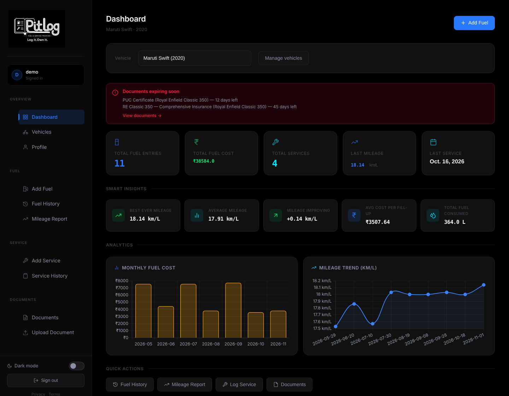

# PitLog


A full-featured Django web application for tracking vehicle fuel consumption, mileage efficiency, service records, and documents. Built for bike and car owners who want clean data and real insights.

**Live app:** [ak-pitlog.vercel.app](https://ak-pitlog.vercel.app)

<!-- TODO: add 2–3 screenshots or a short GIF of the dashboard here, e.g.

-->

---

## Try it locally with demo data

```bash
python manage.py migrate
python manage.py seed_demo   # creates user demo / demo1234 with 2 vehicles and 6 months of data
python manage.py runserver
```

Then sign in at <http://localhost:8000> as `demo` / `demo1234`.

---

## Features

**Fuel Tracking**
- Log every fill-up: litres, cost, odometer, full-tank flag
- Tank-to-tank mileage calculation (km/L)
- Odometer rollback protection

**Analytics & Charts**
- Monthly fuel cost bar chart
- Mileage trend line chart with average overlay
- Cost per km chart
- Service cost breakdown by vehicle
- Smart insights: best/average mileage, trend direction, avg cost per fill-up

**Service Records**
- Log any service type: oil change, tyre change, chain lube, etc.
- Full odometer-based service history

**Document Storage**
- Upload insurance, RC book, PUC certificate, invoices, warranties
- Expiry tracking with colour-coded status (ok / warning / critical / expired)
- Dashboard banner for documents expiring within 60 days
- Secure per-user file storage via Backblaze B2

**User Accounts**
- Register, login, logout
- Email OTP verification required at registration (6-digit code, expires in 10 minutes)
- Sign in afterwards with either your password or a fresh emailed OTP — your choice each time
- Profile with display name, bio, notification preferences
- All data is private and scoped per user
- Public landing page at `/` for signed-out visitors; signed-in users see their dashboard at the same URL

**Export**
- Download fuel history, service history, and mileage report as CSV
- UTF-8 BOM for seamless Excel compatibility

**PWA — Progressive Web App**
- Installable on Android, iOS, and desktop (Chrome/Edge)
- Offline fallback page
- App shortcuts to Add Fuel and Add Service
- Service worker caches CSS/fonts for fast repeat loads

**Accessibility (WCAG 2.1 AA)**
- Skip-to-content link
- `aria-current`, `aria-live`, `aria-modal`, `aria-required` throughout
- Focus-visible rings for keyboard navigation
- `prefers-reduced-motion` support
- Print-friendly stylesheet

**Design**
- Dark mode / light mode / auto toggle (persisted in localStorage, no flash)
- Lucide SVG icons — no emojis
- DM Sans + Space Mono fonts
- Carbon Black & Electric Blue colour scheme
- Responsive — works on mobile, tablet, desktop

---

## Tech Stack

| Layer        | Technology                          |
|--------------|-------------------------------------|
| Backend      | Django 5.2, Python 3.12             |
| Database     | SQLite (local) / PostgreSQL (prod)  |
| File Storage | Backblaze B2 (S3-compatible)        |
| Static files | WhiteNoise (gzip + cache-busting)   |
| Charts       | Chart.js 4.4                        |
| CSS          | Custom design system (no Tailwind)  |
| PWA          | Vanilla service worker              |

---

## Local Setup

### 1. Clone the repository

```bash
git clone https://github.com/akshobyaas/fuel-service-tracker.git
cd fuel-service-tracker
```

### 2. Create virtual environment

```bash
python -m venv venv
source venv/bin/activate       # Windows: venv\Scripts\activate
```

### 3. Install dependencies

```bash
pip install -r requirements.txt
```

### 4. Configure environment

```bash
cp .env.example .env
# Edit .env — set a strong SECRET_KEY
```

`.env.example`:
```
SECRET_KEY=your-secret-key-here
DEBUG=True
ALLOWED_HOSTS=localhost,127.0.0.1
DATABASE_URL=
USE_S3=False

# Optional — without these, OTP codes are printed to the console/terminal
# instead of emailed, which is fine for local dev.
EMAIL_HOST_USER=
EMAIL_HOST_PASSWORD=
```

### Email OTP setup (free, via Gmail)

Registration requires a 6-digit code emailed to the user before their account is
activated; afterwards they can log in with either their password or a fresh OTP.
With no email credentials configured, codes are printed to the console instead of
sent — usable for local development and demos, but not for real users.

To send real emails for free using a Gmail account:

1. Turn on 2-Step Verification on the Google account: https://myaccount.google.com/security
2. Create an App Password: https://myaccount.google.com/apppasswords
3. Set these in `.env`:
   ```
   EMAIL_HOST_USER=youraddress@gmail.com
   EMAIL_HOST_PASSWORD=the-16-character-app-password
   ```

Optional tuning (all have sensible defaults):

| Variable                       | Default | Meaning                                  |
|---------------------------------|---------|-------------------------------------------|
| `EMAIL_HOST`                    | `smtp.gmail.com` | SMTP server (only used if `EMAIL_HOST_USER`/`PASSWORD` are set) |
| `EMAIL_PORT`                    | `587`   | SMTP port                                  |
| `EMAIL_USE_TLS`                 | `True`  | Use STARTTLS                               |
| `DEFAULT_FROM_EMAIL`            | your `EMAIL_HOST_USER`, or `PitLog <noreply@pitlog.local>` | "From" address on OTP emails |
| `OTP_EXPIRY_MINUTES`            | `10`    | How long a code stays valid                |
| `OTP_MAX_ATTEMPTS`              | `5`     | Wrong guesses allowed before a code is locked out |
| `OTP_RESEND_COOLDOWN_SECONDS`   | `60`    | Minimum wait between two codes for the same purpose |

### 5. Run migrations

```bash
python manage.py migrate
```

### 6. Seed demo data (optional)

```bash
python manage.py seed_demo
```

Creates demo user (`demo` / `demo1234`) with 2 vehicles, 6 months of fuel entries, service records, and documents including one expiring soon.

### 7. Run the dev server

```bash
python manage.py runserver
```

Open [http://localhost:8000](http://localhost:8000).

### 8. Run the test suite (optional)

```bash
python manage.py test trk
```

Covers registration + OTP verification, password and OTP login (including the
login-attempt throttle and resetting a forgotten password via OTP), that one
user can never reach another user's vehicles/fuel/service data, the
chronological odometer-ordering validator, and auth hardening (no open
redirect via `?next=`, no wiping someone else's pending sign-up, no throttle
bypass via a spoofed `X-Forwarded-For` header).

---

## Production Configuration

### Environment variables

| Variable                | Description                              |
|-------------------------|------------------------------------------|
| `SECRET_KEY`            | Long random string                       |
| `DEBUG`                 | `False`                                  |
| `ALLOWED_HOSTS`         | Your domain                              |
| `CSRF_TRUSTED_ORIGINS`  | `https://yourdomain.com`                 |
| `DATABASE_URL`          | PostgreSQL connection string             |
| `USE_S3`                | `True` to enable Backblaze B2 storage    |
| `AWS_ACCESS_KEY_ID`     | Backblaze B2 key ID                      |
| `AWS_SECRET_ACCESS_KEY` | Backblaze B2 application key             |
| `AWS_STORAGE_BUCKET_NAME` | B2 bucket name                         |
| `AWS_S3_ENDPOINT_URL`   | B2 endpoint URL                          |
| `EMAIL_HOST_USER`       | Gmail address to send OTP emails from    |
| `EMAIL_HOST_PASSWORD`   | Gmail App Password (not your normal password) |

### Production checklist

- **`SECRET_KEY` is required when `DEBUG=False`.** The app will refuse to start rather than fall back to an insecure default — set a long random value as an env var.
- **Set `ALLOWED_HOSTS` and `CSRF_TRUSTED_ORIGINS` to your real domain(s).** The defaults only cover `localhost`/`127.0.0.1` for local dev; there is no wildcard fallback.
- **Enable `USE_S3` unless your host gives this app a persistent disk.** Without it, uploaded documents/avatars are written to local disk, which most PaaS free tiers (Render, Railway, etc.) wipe on every redeploy or restart. `python manage.py check` will warn (`trk.W001`) if this looks misconfigured.
- **Set `EMAIL_HOST_USER`/`EMAIL_HOST_PASSWORD` before accepting real users.** Without them, OTP codes for registration and login only go to the console, so nobody outside your own terminal can ever complete registration or sign in via OTP. `python manage.py check` will warn (`trk.W002`) if this looks misconfigured.

---

## Project Structure

```
fuel-service-tracker/
├── fstp/                        # Django project settings
│   ├── settings.py
│   ├── urls.py
│   └── wsgi.py
├── trk/                         # Main app
│   ├── models.py                # Vehicle, FuelEntry, ServiceRecord, Document, UserProfile
│   ├── views.py                 # All views incl. exports, PWA, chart APIs
│   ├── forms.py                 # ModelForms with validation
│   ├── urls.py                  # All URL routes
│   ├── admin.py                 # Admin registration
│   ├── signals.py               # Auto UserProfile creation
│   ├── migrations/
│   ├── management/commands/
│   │   └── seed_demo.py         # Demo data seeder
│   ├── static/trk/css/
│   │   └── style.css            # Full design system
│   └── templates/trk/
│       ├── base.html            # Layout, sidebar, theme toggle
│       ├── home.html            # Dashboard with charts + insights
│       ├── vehicles.html
│       ├── fuel_entry.html
│       ├── fuel_history.html
│       ├── mileage.html
│       ├── service_entry.html
│       ├── service_history.html
│       ├── documents.html
│       ├── profile.html
│       ├── auth/                # login.html, register.html, verify_otp.html
│       ├── errors/              # 404.html, 500.html
│       └── pwa/                 # manifest.json, offline.html
├── static/
│   ├── js/sw.js                 # Service worker
│   └── pwa/                     # PWA icons
├── manage.py
├── requirements.txt
└── .env.example
```

---

## URL Reference

| URL | Description |
|-----|-------------|
| `/` | Landing page (signed out) / Dashboard (signed in) |
| `/register/` | Create account |
| `/login/` | Sign in (password or OTP) |
| `/verify-otp/` | Enter the 6-digit emailed code (registration or OTP login) |
| `/vehicles/` | Vehicle list |
| `/fuel/` | Add fuel entry |
| `/fuel-history/` | Fuel history |
| `/mileage/` | Mileage report |
| `/service/` | Add service record |
| `/service-history/` | Service history |
| `/documents/` | Document list |
| `/documents/add/` | Upload document |
| `/profile/` | User profile |
| `/export/fuel/` | CSV export — fuel |
| `/export/service/` | CSV export — service |
| `/export/mileage/` | CSV export — mileage |
| `/api/chart/mileage/<id>/` | Mileage chart data |
| `/api/chart/monthly-cost/<id>/` | Monthly cost chart data |
| `/api/chart/service-breakdown/<id>/` | Service cost chart data |

---

## Development Phases

| Phase | Focus |
|-------|-------|
| 1 | Core models, Django forms, security (@require_POST, CSRF) |
| 2 | Premium UI design system, dark/light/auto mode |
| 3 | Chart.js analytics, smart insights, Lucide SVG icons |
| 4 | Document storage, expiry tracking, Backblaze B2 |
| 5A | Performance (select_related/prefetch_related), PWA, WhiteNoise |
| 5B | CSV export for fuel, service, mileage |
| 5C | Accessibility (WCAG 2.1 AA) |
| 5D | Skeleton loaders, print styles, animations |
| 6 | User profiles, feedback system, notification preferences |

---

## License

MIT — free to use, modify, and deploy.